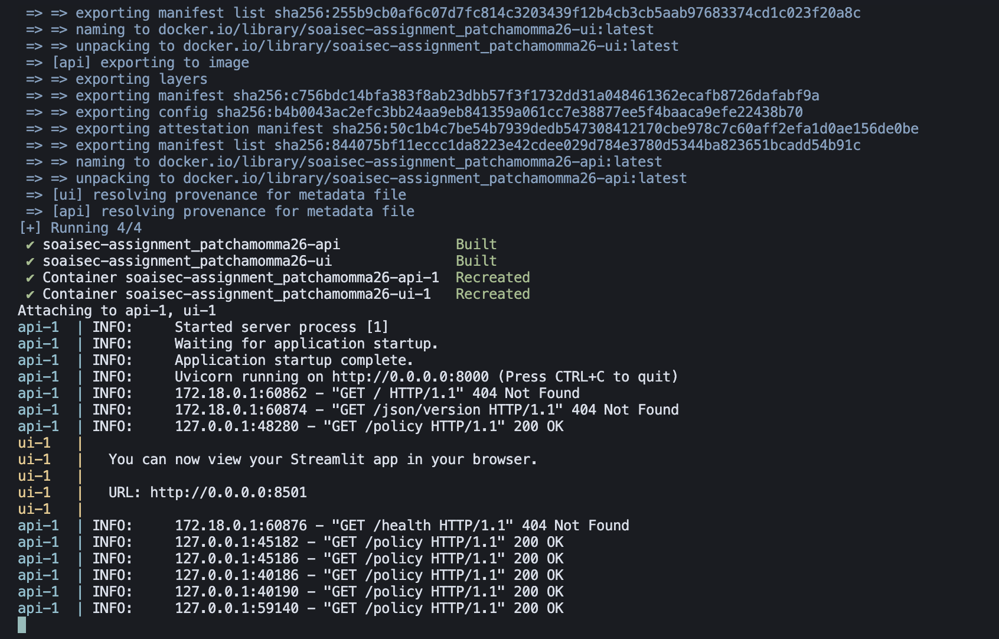
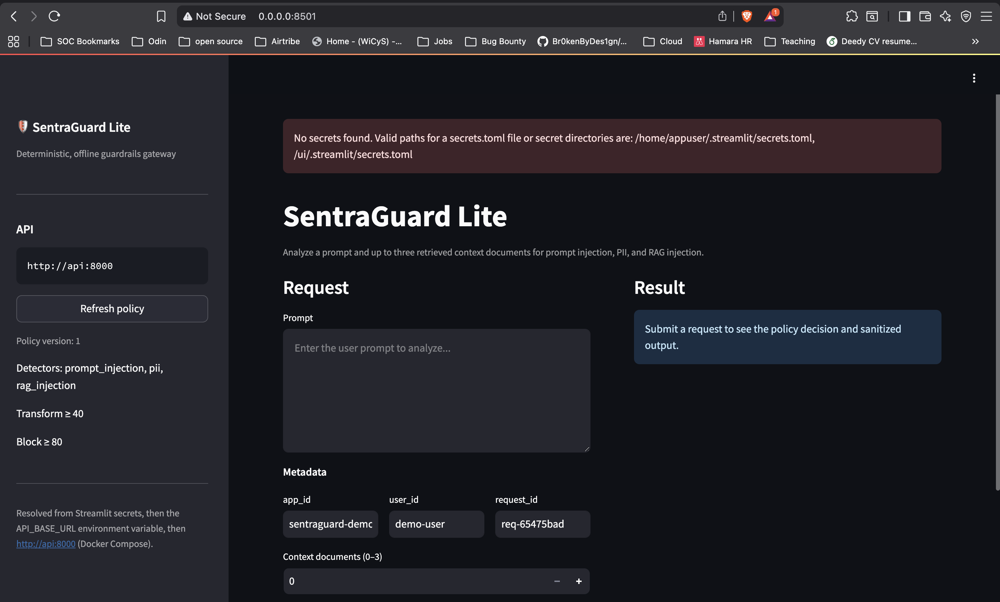

# SentraGuard Lite --- Submission Evidence Checklist
------------------------------------------------------------------------

## 1. Deliverables

### 1.1 Git repository link or ZIP shared

https://github.com/schmithvillers/SentraGuard-Lite

### 1.2 Working FastAPI service with exactly two specified endpoints

### 1.3 Working Streamlit UI

https://sentra-guard-lite.streamlit.app/

### 1.4 Working CLI command
Input file: `sample_request.json` 
Generated output file: `out.json` 

### 1.5 Docker Compose works without manual edits

Compose configuration: `docker-compose.yml` 
API Dockerfile: `Dockerfile.api`
UI Dockerfile: `Dockerfile.ui` 

### 1.6 API reachable at localhost:8000

### 1.7 UI reachable at localhost:8501

### 1.8 Hosted demo or screen recording

https://sentra-guard-lite.streamlit.app/

------------------------------------------------------------------------

## 2. Tests

### 2.1 Ten required pytest tests included

-   [ ] At least ten meaningful pytest tests are included.
-   [ ] Tests cover the required core behavior and assignment scenarios.

**Evidence to add:** - Test directory: `tests/` - Test files:
`[LIST ACTUAL TEST FILES HERE]` - Test count / collection output:
`screenshots/tests/[ADD PYTEST COLLECTION OR SUMMARY SCREENSHOT]`

### 2.2 Tests pass locally or in Docker

------------------------------------------------------------------------

## 3. Documentation

### 3.1 README.md

File: `README.md` 

### 3.2 Design Notes section

File: `docs/design-notes.md`

### 3.3 Dashboard test-results report
Report: `result.md` 

------------------------------------------------------------------------

## 4. Security and quality

### 4.1 No secrets committed

Ignore rules: `.gitignore` 

### 4.2 No unintended raw PII storage or logging

File: app/core/pii.py

### 4.3 Deterministic behavior and offline/mock operation

File: app/core/scoring.py
Test: tests/test_scoring_policy.py

### 4.4 Clear error messages for invalid inputs
File: tests/test_api.py

------------------------------------------------------------------------

## 5. Final verification

These are the end-to-end checks listed in the assignment. Record the
actual evidence for each one.

### 5.1 Docker Compose starts successfully

### 5.2 UI triggers the core flow end-to-end

### 5.3 CLI works against the running API

### 5.4 Tests pass and cover core logic

### 5.5 Code is readable and maintainable
Yes

------------------------------------------------------------------------

## 6. Final submission record

Complete this section immediately before submitting.

  Submission detail            Value
  ---------------------------- -----------------------------------------------
  Project name                 SentraGuard Lite
  Repository URL               `https://github.com/schmithvillers/SentraGuard-Lite`
  Hosted demo URL              `https://sentra-guard-lite.streamlit.app/`
  Final test command           `pytest -q`
  Final test result            `76 passed, 1 warning in 0.20s`
  Date of final verification   `[2026-10-30]`

------------------------------------------------------------------------

