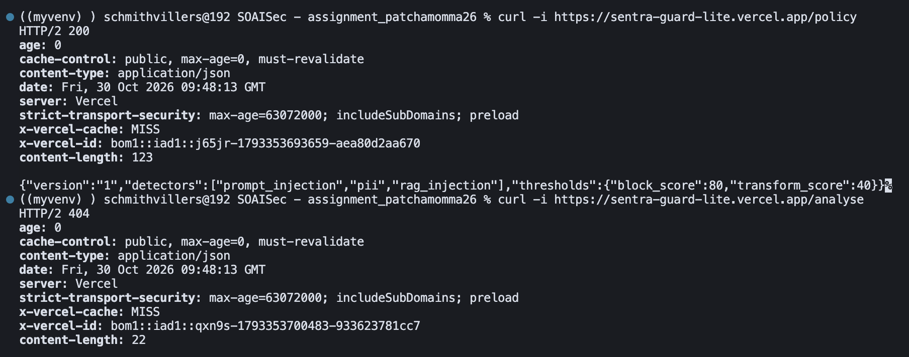
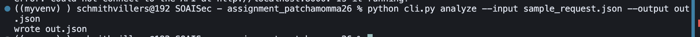
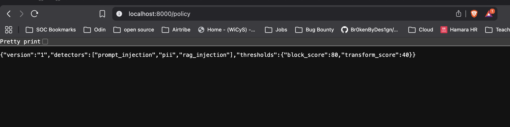
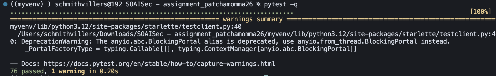
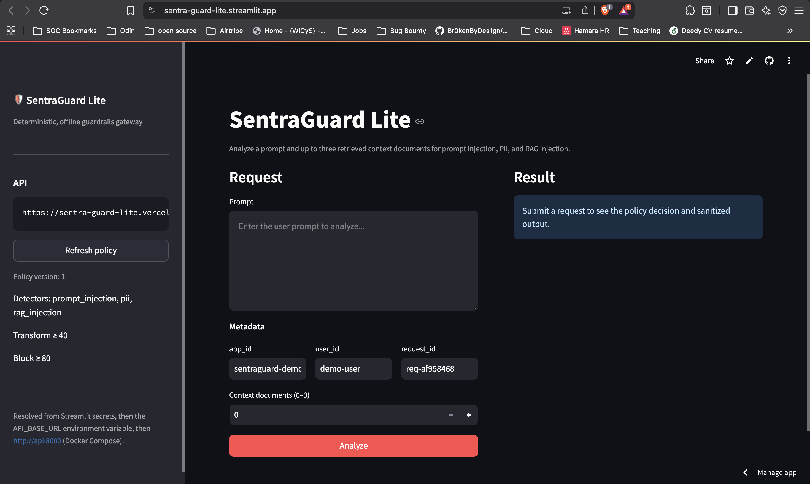

# SentraGuard Lite — Submission Evidence Checklist

Use this checklist before submitting. Image links in this document are relative to the repository root. Keep the `screenshots/` directory beside this file and commit the image files themselves.

## 1. Deliverables

### 1.1 Git repository link or ZIP shared

https://github.com/schmithvillers/SentraGuard-Lite

### 1.2 Working FastAPI service with exactly two specified endpoints



### 1.3 Working Streamlit UI

https://sentra-guard-lite.streamlit.app/

### 1.4 Working CLI command

Input file: `sample_request.json`  
Generated output file: `out.json`



### 1.5 Docker Compose works without manual edits

Compose configuration: `docker-compose.yml`  
API Dockerfile: `Dockerfile.api`  
UI Dockerfile: `Dockerfile.ui`


### 1.6 API reachable at localhost:8000



### 1.7 UI reachable at localhost:8501


### 1.8 Hosted demo or screen recording

https://sentra-guard-lite.streamlit.app/

## 2. Tests

### 2.1 Ten required pytest tests included

- [ ] At least ten meaningful pytest tests are included.
- [ ] Tests cover the required core behavior and assignment scenarios.

**Evidence to add:**
- Test directory: `tests/`
- Test files: `[LIST ACTUAL TEST FILES HERE]`
- Test count / collection output: `screenshots/tests/pytest-collection.png`

### 2.2 Tests pass locally or in Docker



## 3. Documentation

### 3.1 README.md

File: `README.md`

### 3.2 Design Notes section

File: `docs/design-notes.md`

### 3.3 Dashboard test-results report

Report: `results.md`

## 4. Security and quality

### 4.1 No secrets committed

Ignore rules: `.gitignore`

### 4.2 No unintended raw PII storage or logging

File: `app/core/pii.py`

### 4.3 Deterministic behavior and offline/mock operation

File: `app/core/scoring.py`  
Test: `tests/test_scoring_policy.py`

### 4.4 Clear error messages for invalid inputs

File: `tests/test_api.py`

## 5. Final verification

These are the end-to-end checks listed in the assignment. Record the actual evidence for each one.

### 5.1 Docker Compose starts successfully


### 5.2 UI triggers the core flow end-to-end



### 5.3 CLI works against the running API


### 5.4 Tests pass and cover core logic


### 5.5 Code is readable and maintainable

[ ] Reviewed and confirmed.

## 6. Final submission record

Complete this section immediately before submitting.

| Submission detail | Value |
|---|---|
| Project name | SentraGuard Lite |
| Repository URL | https://github.com/schmithvillers/SentraGuard-Lite |
| Hosted demo URL | https://sentra-guard-lite.streamlit.app/ |
| Final test command | `pytest -q` |
| Final test result | `76 passed, 1 warning` (replace with the final actual run) |
| Date of final verification | `[YYYY-MM-DD]` |

## 7. Required screenshot directory structure

Create this structure in the repository root. Use the exact filenames referenced above, or update the Markdown links to match the filenames you actually use.

```text
screenshots/
├── api/
│   ├── api-endpoints.png
│   ├── api-localhost-8000.png
│   └── ui-localhost-8501.png
├── cli/
│   └── cli-working.png
├── dashboard/
│   └── dashboard-end-to-end.png
├── docker/
│   └── docker-compose.png
└── tests/
    ├── pytest-collection.png
    └── pytest-results.png
```

The dashboard scenario screenshots used in `results.md` are stored under `screenshots/dashboard/` with the five filenames listed in that report.

**Important:** The filenames above are a normalized naming convention. Rename your actual screenshot files to match them, or edit the links. A Markdown image link will not display if its target file does not exist. Do not use a leading slash in repository-relative paths.
